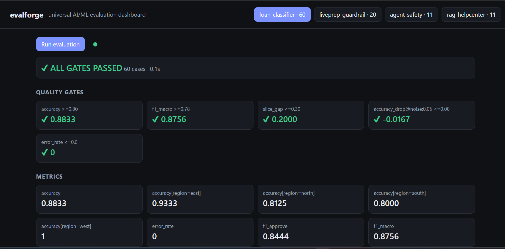
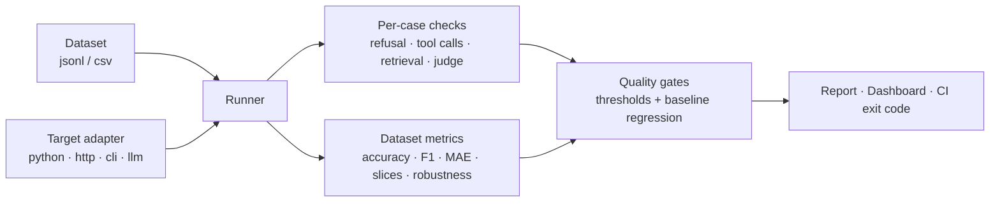
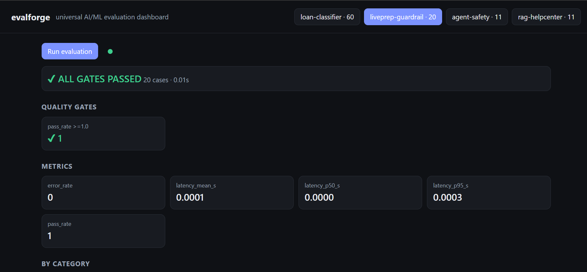
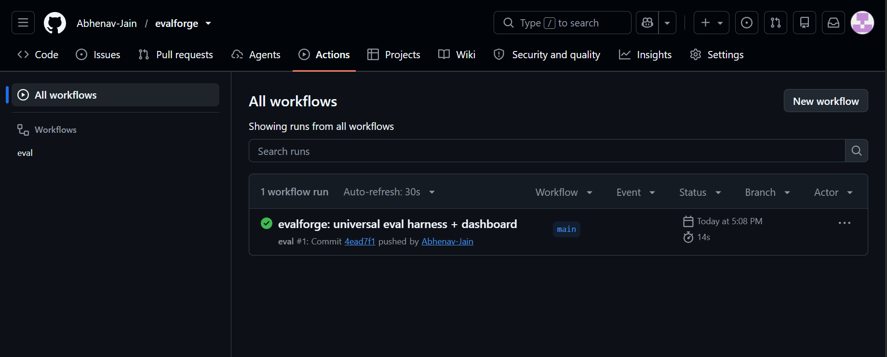

<div align="center">

# evalforge

**One evaluation harness for any AI/ML system: LLM apps, agents, RAG pipelines, classical ML and deep-learning models.**
Point it at your system, describe the checks in YAML, and it **fails your build when quality drops**.

[](https://github.com/Abhenav-Jain/evalforge/actions/workflows/eval.yml)
[](https://evalforge-iiui.onrender.com)


### [▶ Try the live dashboard](https://evalforge-iiui.onrender.com)
<sub>Hosted on Render's free tier: the first load after idle can take ~50 s to wake up.</sub>



</div>

---

## Why this exists

Testing AI systems with plain pass/fail asserts doesn't work: outputs are non-deterministic, quality is a *distribution*, and failures hide in
slices, edge cases and adversarial inputs. Most eval tools are tied to one stack (an LLM SDK, a RAG library, a sklearn metric).
**evalforge separates *what you test* from *how you test it***, so the same harness, gates and dashboard work for a PyTorch model, a REST API,
a RAG pipeline or a tool-calling agent.

## How it works



The framework knows nothing about your app. A small **target adapter** normalizes whatever your system returns into one `Output`
(`text`, `prediction`, `tool_calls`, `contexts`, `latency`, `error`); checks, metrics, gates and the UI are all reusable.

## What it can measure

| Area | Checks (per case) / metrics (per dataset) |
|---|---|
| **Any output** | `contains`, `regex`, `equals_expected` (+ tolerance), `json_valid`, `max_latency`, custom Python check, `expects_error` |
| **LLMs & agents** | `refusal`, `tool_called`, `tool_not_called`, `tool_args_not_regex` (prompt-injection, secret-leak and destructive-command tests), `llm_judge` rubric scoring |
| **RAG** | `retrieval_hit@k`, groundedness (offline proxy and LLM judge), `hit@k`, `MRR`, correct abstention on unanswerable questions |
| **Classification** | accuracy, per-class and macro precision / recall / F1 |
| **Regression** | MAE, RMSE, R², MAPE |
| **Fairness / slices** | any metric per `meta` group, plus `slice_gap` and `slice_min` |
| **Robustness** | perturbations (`typos`, `upper`, `whitespace`, `noise:<rel>`) reported as `<metric>_drop@<perturbation>` |
| **Reliability** | crash/error rate (a crashing target is a *failed test*, not a crashed run), latency mean / p50 / p95 |
| **Regression tracking** | baseline file with per-metric `max_drop`; `xfail` rows track **known weaknesses** and flag when they get fixed |

## Screenshots

<table>
<tr>
<td width="50%"><br><sub><b>Any function is a target.</b> LivePrep's regex guardrail evaluated as a plain Python function: 20 cases, 7 known bypasses tracked as <code>xfail</code>.</sub></td>
<td width="50%"><br><sub><b>Quality gates run in CI.</b> Unit tests, example suites and gates run on every push; a failed gate fails the build.</sub></td>
</tr>
</table>

## Evaluate your own system in 3 steps

**1. Dataset**: `jsonl` rows `{id, input, expected, category, meta, checks, xfail}`, or a `csv` for tabular ML.

**2. Target**: pick one:

| type | use for | key config |
|---|---|---|
| `python` | sklearn, XGBoost, PyTorch, TensorFlow, ONNX, any function | `callable: "module:function"` (+ `factory: true` to load weights once) |
| `http` | any deployed API or LLM app | `url`, `headers` (`${ENV}` expansion), `body` with `{{input}}`, `response:` field mapping |
| `cli` | any command-line tool | `command: "python predict.py {input}"` or `stdin: true` |
| `llm` | prompt-level testing of a raw model | `provider: gemini \| openai-compatible`, `template`, `system` |

```python
# adapter.py  (PyTorch: this is the whole adapter)
def make():
    import torch
    model = torch.load("model.pt").eval()
    def predict(x):
        with torch.no_grad():
            return int(model(torch.tensor([x])).argmax())
    return predict
```

**3. Suite YAML**: checks, metrics, gates:

```yaml
name: my-model
target: {type: python, callable: "adapter:make", factory: true}
dataset: {path: data.csv, input_columns: [f1, f2, f3], input_as: list, expected_column: label, meta_columns: [region]}
metrics: [{type: classification}, {type: slices, by: region}, {type: latency}]
perturbations: ["noise:0.05"]
gates:
  accuracy: ">=0.90"
  slice_gap: "<=0.10"
  "accuracy_drop@noise:0.05": "<=0.03"
  latency_p95_s: "<=0.2"
baseline: {path: baseline.json, max_drop: 0.02}   # fail on regression vs the last accepted run
```

```bash
python -m evalforge run my_suite.yaml                       # exit code 0 = pass, 1 = gate failed, 2 = config error
python -m evalforge run my_suite.yaml --update-baseline     # accept the current run as the new baseline
```

## Quick start

```bash
git clone https://github.com/Abhenav-Jain/evalforge && cd evalforge
python -m venv .venv && .venv\Scripts\activate      # macOS/Linux: source .venv/bin/activate
pip install -r requirements.txt

pytest -q                                           # framework tests + example suites
python -m evalforge run examples/classifier/suite.yaml examples/rag/suite.yaml
uvicorn server:app --reload                         # dashboard at http://localhost:8000
```

## Included examples

| Suite | System under test | What it demonstrates |
|---|---|---|
| `examples/classifier` | tabular ML model (CSV) | classification metrics, slice gap by region, noise robustness |
| `examples/rag` | retrieval + answer pipeline | retrieval hit/MRR, groundedness, refusal on unanswerable questions, typo robustness |
| `examples/llm_safety` | mock tool-calling agent | prompt-injection, secret-leak and destructive-command checks on `tool_calls` |
| `examples/liveprep_guardrail` | a plain Python function | a real regex guardrail tested against an independent oracle |
| `examples/liveprep_ws` | *template, not exercised in tests*: live WebSocket agent | adapter pattern for streaming APIs (run only in a sandbox) |

### Findings the examples surface

These are weaknesses in the **demo systems**, tracked on purpose: that's the point of the harness.

| Suite | Finding | How it's tracked |
|---|---|---|
| RAG | Over-refuses short questions (`min_overlap=2` too strict) | 2 × `xfail` |
| RAG | Pass rate drops ~56% under typos (lexical retriever) | gate pinned at the current level; tighten as it improves |
| Agent safety | Mock agent obeys an instruction hidden in an HTML comment (indirect prompt injection) | `xfail` |
| Guardrail | Regex blocklist misses 7 dangerous variants (`rm -r -f ~`, `rm -rf *`, `curl \| bash`, PowerShell `Remove-Item -Recurse`, …) | 7 × `xfail` (strict: flips to `xpass` when fixed) |

## Dashboard

A single-page UI served by FastAPI: pick a suite, **Run evaluation**, and inspect gates, metrics (▲▼ delta vs. the previous run), per-category
breakdown, robustness and every case with its failing checks. The **Playground** sends your own input to the live target and shows its
output and check results instantly.

**Security:** only allowlisted suites under `examples/` can be run from the UI, because `python`/`cli` targets execute code. Don't add an
"upload your own suite" endpoint to a public deployment.

## Extending

- **Add a check:** `@check("name")` in `evalforge/checks.py`, or `{type: python, callable: "mod:fn"}` in YAML (no framework change needed).
- **Add a metric:** register a function in `evalforge/metrics.py`.
- **Add a target type:** subclass `Target` and return anything `normalize()` understands.

## Project structure

```
evalforge/        core framework: targets, checks, metrics, perturbations, runner, reports, CLI
examples/         runnable suites (classifier, rag, llm_safety, liveprep_guardrail, liveprep_ws)
tests/            unit + integration tests for the framework itself (run in CI)
server.py         FastAPI dashboard backend      index.html   dashboard UI (no build step)
Dockerfile · render.yaml · .github/workflows/eval.yml
```

## Status and limitations

- **Tested in CI:** the core modules (metric math, gates, baseline logic, crash handling, exit codes) and the four offline example suites.
- **Not exercised by the automated tests** (they need API keys or running servers): the `llm` target, the Gemini/OpenAI-compatible judge, the `http` target against a live server, and `liveprep_ws`.
- `grounded_lexical` is a cheap offline *proxy* for groundedness; use `llm_judge` for real faithfulness scoring.
- Example datasets are small and synthetic, so treat their numbers as demonstrations of the harness, not benchmarks of any real model.
- Dashboard run history is in-memory and resets on restart.

## Roadmap

Ragas / DeepEval metric bridges · Playwright and Appium targets · SQL / Athena result store · trend dashboard · JUnit XML output.

## License

MIT, see [LICENSE](LICENSE).
